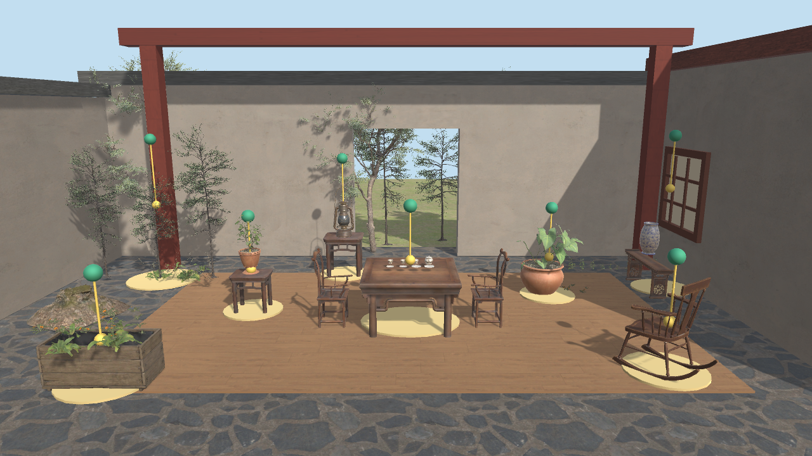
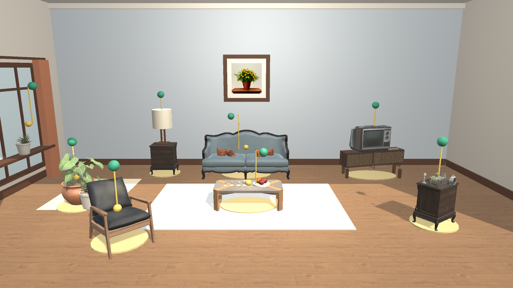
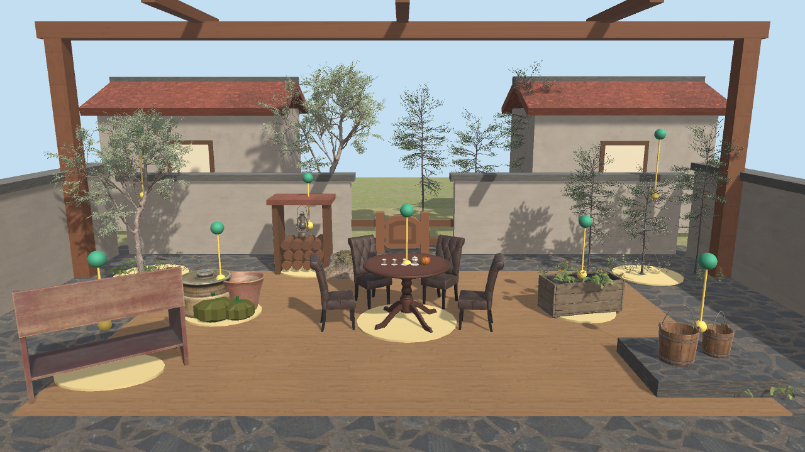
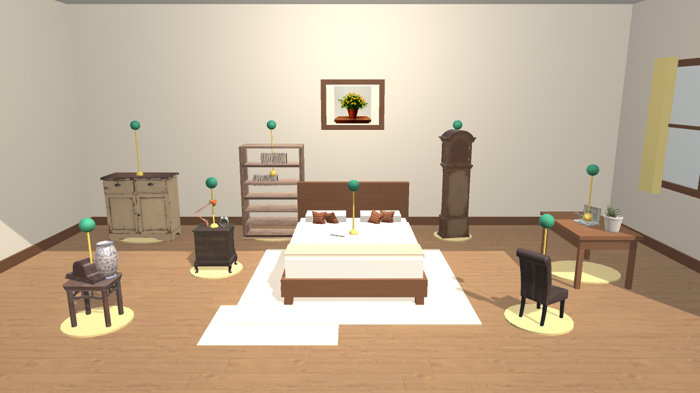
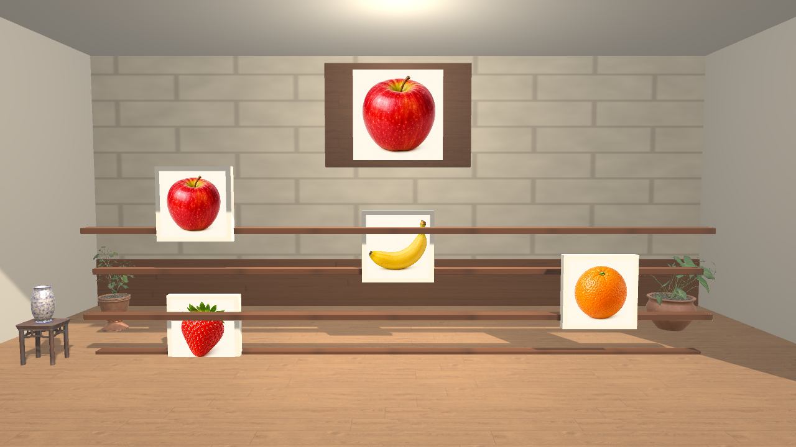
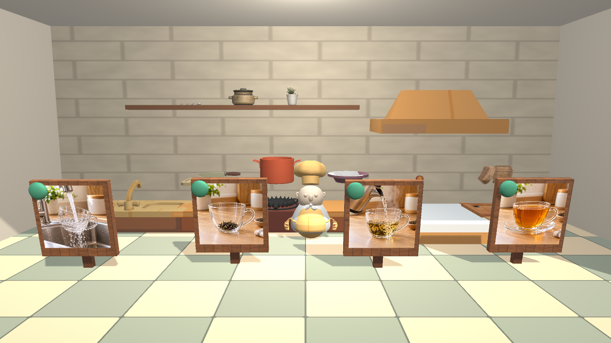

# 忆境 3D · 老年认知训练与评估系统

基于 Unity 的 3D 认知训练项目，提供记忆花园、注意力追踪和厨房步骤三类交互训练，以及训练记录、统计分析与认知任务表现评估。



## 功能

- **记忆花园**：在老家小院、温馨客厅、农家院落和阳光书房卧室等 3D 场景中观察物品，并按提示点击目标物品。
- **注意力追踪**：15 个主题，通过移动目标的选择训练视觉注意力。
- **厨房步骤**：10 个任务，通过排列或选择操作步骤练习顺序规划。
- **训练方式**：三档难度、练习与正式训练、操作示范、每日三合一训练。
- **数据与评估**：本地训练记录、450 条明确标记为模拟数据的演示记录、五维任务表现分析，以及 HTML 报告与 CSV 导出。

## 环境

- Unity **6000.6.2f1**，版本记录见 `ProjectSettings/ProjectVersion.txt`。
- Git 和 **Git LFS**。工程包含较大的 FBX 模型与纹理，完整资源约 1.07 GB。
- 首次打开需要联网恢复 Unity 包，并预留额外磁盘空间供 Unity 生成导入缓存。

## 下载与运行

先安装 Git LFS，再克隆工程：

```sh
git lfs install
git clone https://github.com/xsy3293174792-stack/yijing-unity3d.git
cd yijing-unity3d
git lfs pull
```

1. 在 Unity Hub 中选择 **Add / 从磁盘添加项目**，选择包含 `Assets`、`Packages` 和 `ProjectSettings` 的仓库根目录。
2. 使用 Unity **6000.6.2f1** 打开，等待依赖恢复和素材导入结束。
3. 打开 `Assets/Scenes/YijingMain.unity`。
4. 点击 Unity 的 **Play**，从训练首页选择游戏或进入今日训练。
5. 使用鼠标操作界面，并点击 3D 场景中的目标物品。

**推荐按上述方式克隆。** 如果模型缺失，或 FBX 文件打开后只有几行以 `version https://git-lfs.github.com/spec/v1` 开头的文本，说明尚未下载 LFS 资源，请运行 `git lfs pull` 后重新导入。下载仓库 ZIP 后也请确认大文件内容完整。

## 工程结构

```text
Assets/
  Editor/                       场景构建与组合玩法验证入口
  Prefabs/Yijing/                三类训练场景预制体
  Resources/Yijing/              模型、贴图、图标、任务及模拟数据
  Scenes/YijingMain.unity        主场景
  Scripts/Yijing/
    Analytics/                  评估与报告导出
    Core/                       训练流程与资源加载
    Data/                       数据模型
    UI/                         界面与交互流程
    World3D/                    3D 场景生成与点击交互
Packages/                       依赖清单和锁定文件
ProjectSettings/                Unity 工程设置
```

`Library`、`Temp`、`Logs`、`UserSettings` 等本地缓存由 Unity 自动生成，无需提交。所有工程素材的 `.meta` 文件均随项目保留。

## 场景预览

| 温馨客厅 | 农家院落 |
| --- | --- |
|  |  |

| 阳光书房卧室 | 注意力追踪 |
| --- | --- |
|  |  |



预览图来自原工程已有的场景渲染结果。

## 构建与验证

- 主场景已经加入 `EditorBuildSettings`。需要制作可运行程序时，在 Unity **File → Build Profiles** 中选择目标平台，并安装对应的构建模块。
- 场景重建入口：**忆境 3D 系统 → 1. 一键构建 3D 场景与预制体**。
- 组合验证入口：**忆境 3D 系统 → 2. 运行全组合玩法与认知评估验证**。
- 验证代码覆盖 12 组记忆任务、45 组注意力任务和 30 组厨房任务，共 87 组，并检查 450 条模拟记录与报告导出。

组合验证会重建并保存主场景和预制体，还会生成示例训练记录及报告。请先保存自己的场景修改。

本次发布检查情况见 [发布验证记录](docs/VALIDATION.md)。当前仓库提供可编辑 Unity 工程；未附独立平台的安装包。

## 数据保存与报告

- 运行记录保存在 `Application.persistentDataPath/YijingSessions` 中。
- HTML 与 CSV 默认导出到工程目录的上一级 `导出报告` 文件夹；HTML 导出失败时使用持久化数据目录作为备用位置。
- 首次运行会生成演示记录，资源中另含 450 条模拟记录，均用于展示和开发验证。

## 素材与授权

第三方素材来源和随附许可证见 [素材署名与授权说明](docs/THIRD_PARTY_ASSETS.md)。本仓库未对项目原创源码另行指定开源许可证；第三方素材继续适用各自原有许可。
